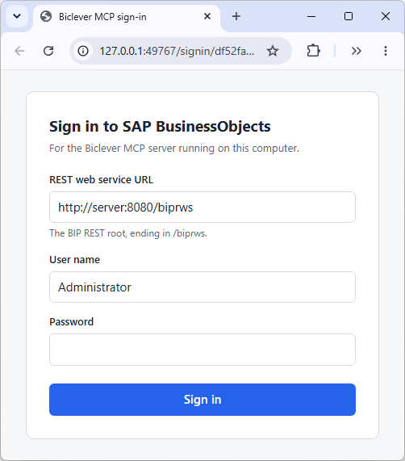

## Requirements

- SAP BusinessObjects BI 4.3 SP3 and later, including BI 2025.
- Java 17 or later.
- Network access to your BIP REST endpoint.
- An Enterprise BIP account with permission to create documents in Web Intelligence (see *Required permissions* below).
- An MCP-compatible client (Claude Desktop, Claude Code, Cursor, etc.).

## 1. Install Java

We recommend [Eclipse Temurin JRE 17](https://adoptium.net/temurin/releases/?package=jre&version=17) — download the installer and run it.

## 2. Download and unpack

Download the BI MCP zip file and unpack it to a preferred location, for example:

`C:\Tools\bimcp\`

The folder contains `bimcp.jar` and `INSTRUCTIONS.md`, your instructions to the assistant (see step 5). If you have a PRO license, put `license.txt` in the same folder, next to `bimcp.jar`. Without it, BI MCP runs in free mode.

## 3. Add it to Claude Desktop

In Claude Desktop, open **Settings → Developer** and click **Edit Config** — this opens `claude_desktop_config.json` in your default editor. Add:

```json
{
  "mcpServers": {
    "bimcp": {
      "command": "java",
      "args": ["-jar", "C:\\Tools\\bimcp\\bimcp.jar"]
    }
  }
}
```

Use your own folder in the path, and write every `\` as `\\`. If the file already has an `mcpServers` section, add the `bimcp` entry inside it.

Restart Claude Desktop fully (tray-icon Quit, then relaunch).

## 4. Sign in

The first time you ask Claude about your universes, a sign-in page opens in your browser:



Enter:

- **REST web service URL** — the BIP REST endpoint (see below).
- **User name** and **password** — your BO Enterprise account.

The page is served only to your own computer. The URL and user name are remembered for next time. The password is kept only while Claude Desktop runs, unless you tick **Remember the password on this computer**: then it is kept in Windows Credential Manager (never in a file) and the next start signs in without the page. To switch to another BO system or user, ask Claude to sign in again or to sign out.

### BIP REST endpoint

If you access SAP BO LaunchPad at:

`https://bip-server/BOE/BI`

then the BIP REST endpoint is usually:

`https://bip-server/biprws`

Contact your SAP BO administrator if you are not sure. The URL can normally be found in the Central Management Console under **Applications → RESTful Web Service**.

## 5. Tell the assistant about your universes (recommended)

`INSTRUCTIONS.md`, next to `bimcp.jar`, is yours to edit. The assistant receives its text when the server starts, so from the first question it knows what the universes don't say themselves: which universe answers which question, business definitions, filters that must always be applied, and prompts that are always answered the same way. For example:

```markdown
Revenue questions: use Finance.unx, not Sales.unx.
Always filter Company = 1 unless the user asks for another company.
```

Restart Claude Desktop after a change. Text inside `<!-- -->` comments is not sent to the assistant, and an empty file means the default text. Keep your copy of the file when you install a new version. The assistant never changes the file: when it learns something worth keeping, it suggests a line for you to add.

## Required permissions

- **Universes**: *View On Demand* access level on every universe you intend to query.
- **Web Intelligence application**: *Full Control* access level.
- **Custom SQL** (`run_custom_sql`, PRO): the right to edit query SQL in Web Intelligence.
- You do **not** need write access to any public folder — BI MCP never saves documents to the CMS. Queries run inside an in-memory document that is discarded with the session.

## Tools

| Tool | Free | PRO | Description |
|---|---|---|---|
| `list_universes` | ✓ | ✓ | List CMS universes by name + folder. |
| `describe_universe(name, …)` | ✓ | ✓ | Folders, dimensions, measures, predefined filters with their backslash-joined paths. Large universes: one folder at a time, keyword search, or a folder outline. |
| `run_query(universe, …)` | preview (10 rows) | full (caller's `limit`) | Ad hoc query against a universe with optional filter tree. Answers the universe's prompts. Returns CSV. |
| `inspect_sql(universe, …)` | ✓ | ✓ | Returns the SQL the query would send to the database without executing it. No row cap (no rows returned). |
| `run_custom_sql(universe, result_objects, sql, …)` | — | ✓ | Runs an edited version of a query's SQL through the universe's connection. Must return one column per result object, in order; must start with `SELECT` (no `WITH`). |
| `sign_in` | ✓ | ✓ | Opens the sign-in page to switch system or user; the current session stays until the new sign-in succeeds. |
| `whoami` | ✓ | ✓ | Tells which system and user are signed in. |
| `sign_out` | ✓ | ✓ | Signs out; the next call opens the sign-in page so you can switch system or user. |
