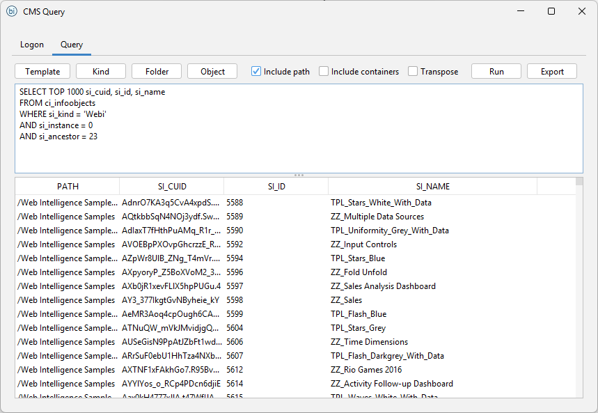
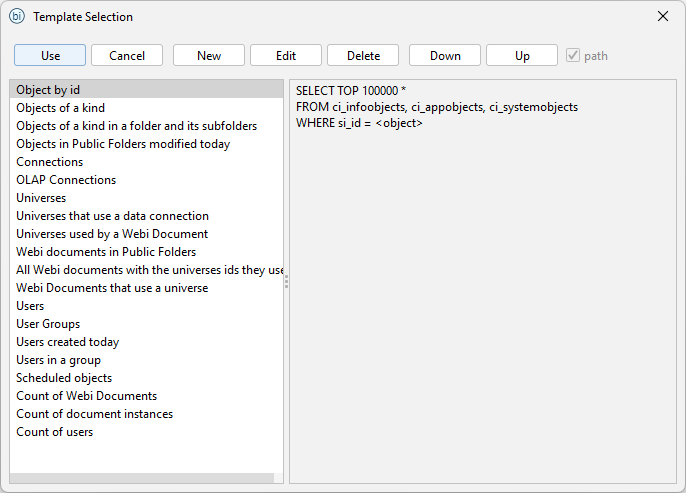
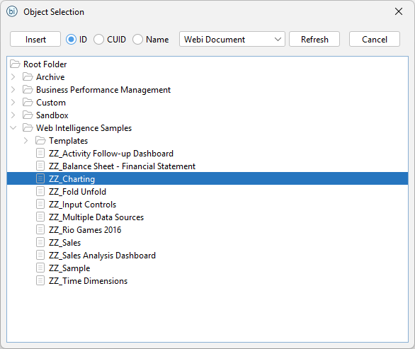
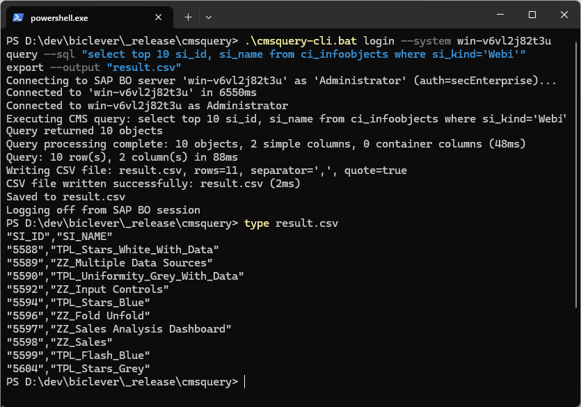

CMS Query Builder is a tool for building CMS queries, running them against the database, and exporting the result to an excel spreadsheet.

- Running queries and exporting result to Excel and CSV.
- Predefined templates of SQL queries.
- Placeholders for `<kind>`, `<object>`, `<folder>` are automatically replaced with a selected item.
- List of object kinds.
- Easy selection of an object or a folder from a tree.
- Word auto-completion for key words, field names, and table names.
- Possibility to customize templates, words for auto-completion, etc., in configuration files.
- Command line interface.

## Prerequisite

You need SAP BusinessObjects Client Tools on your machine. The current download is for BI 4.3 SP3 and later, including BI 2025; older builds are listed below.

## Information

- [CMS Query Builder CLI](/pages/cmsquery-cli/)

## Downloads

- [CMS Query Builder for BI 4.3 SP3 and later, including BI 2025 (cmsquery-20260525.zip)](https://drive.google.com/uc?export=download&id=1dwelL9VmOuUS2eEQSEwaFy01zNkRQcEg)
- [CMS Query Builder for BI 4.3 (cmsquerybuilder-bo43-20240304.zip)](https://drive.google.com/uc?export=download&id=1DqsC9H0AVBKdpwkxQINbRcaI7tVh6W6I)
- [CMS Query Builder for BI 4.1 and BI 4.2 (cmsquerybuilder-bo4x-1.5-20190305.zip)](https://drive.google.com/uc?export=download&id=1bv7VgCS9VMO1nAqcQAAzHW8Gop5k3hBp)
- [CMS Query Builder for XI 3.1 SP5 and later (cmsquerybuilder-bo31sp5-1.5-20190305.zip)](https://drive.google.com/uc?export=download&id=1dwsVf12SKeQDZ7bvn2_hyJhIw3BqT-qA)

## Support

- [support@biclever.com](mailto:support@biclever.com)

## EULA

- [CMS Query Builder End-User License Agreement](/pages/end-user-license-agreement-cms-query-builder/)

## Screenshots

{:.full}

{:.full}

{:.full}

{:.full}

