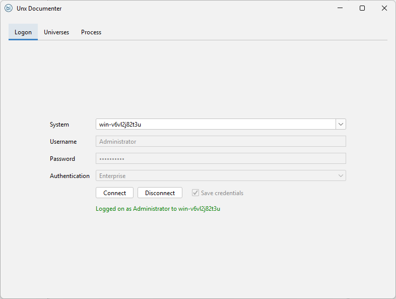
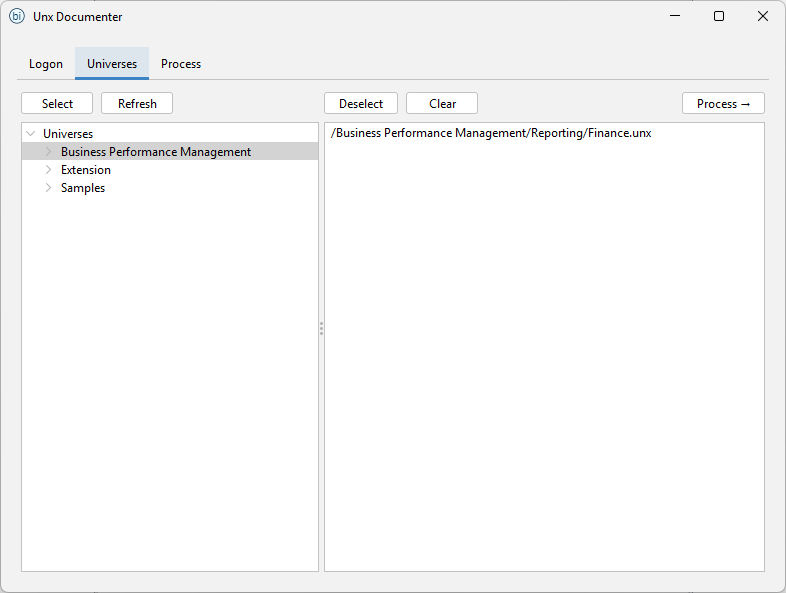
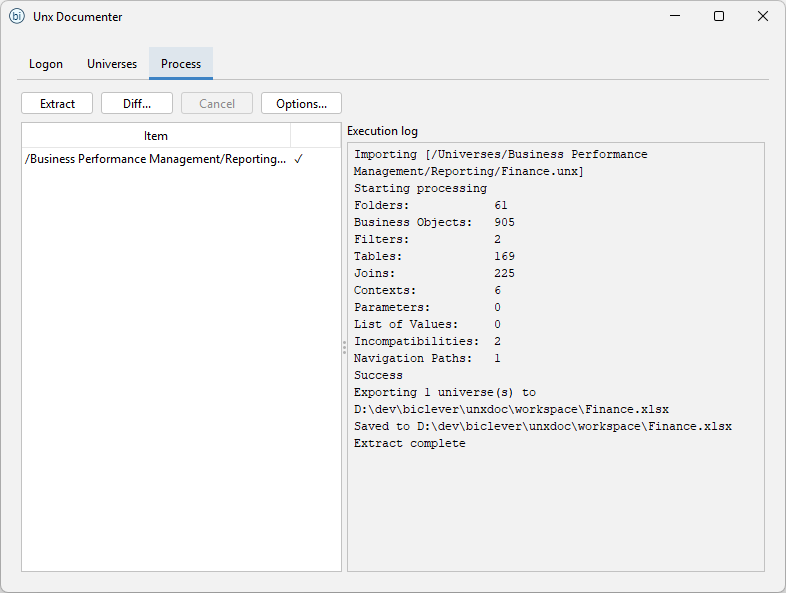
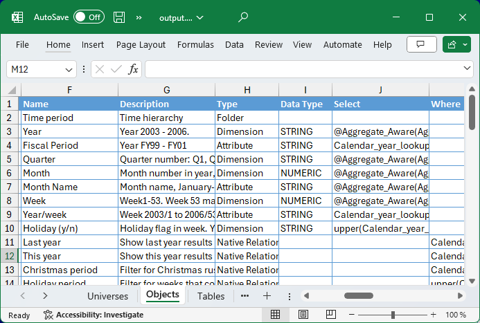
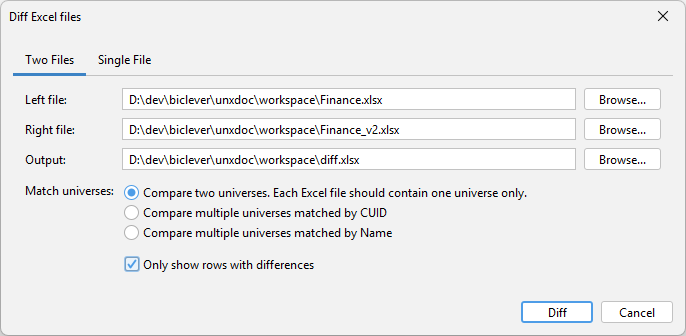

Unx Documenter (UnxDoc) exports UNX universe metadata to an Excel file: objects, tables, joins, lists of values, parameters, contexts, navigation paths and incompatibilities. Use it to document a universe, review its design, or compare two universes, for example across environments or before and after a migration.

- Exports the business layer and data foundation to one workbook, with a sheet per category.
- Compares two universes and highlights the differences (see [Diffing universes with Unx Documenter](/pages/diffing-universes-with-unxdoc/)).
- GUI and command line interface.

## Prerequisite

You need SAP BusinessObjects Client Tools on your machine, with the Semantic Layer Java SDK and Data Security and Access enabled ([how to enable them](/pages/how-to-enable-semantic-layer-sdk/)). The current download is for BI 4.3 SP3 and later, including BI 2025; older builds are listed below.

## Information

- [Unx Documenter CLI](/pages/unxdoc-cli/)
- [Diffing Universes with Unx Documenter](/pages/diffing-universes-with-unxdoc/)
- [How to enable semantic layer SDK](/pages/how-to-enable-semantic-layer-sdk/)
- [Error when running UnxDoc on BO 4.1 SP7](/pages/error-in-unxdoc-on-bo-4-1-sp7-localresourceserviceimpl-load/)

## Downloads

- [Unx Documenter for BI 4.3 SP3 and later, including BI 2025 (unxdoc-20260525.zip)](https://drive.google.com/uc?export=download&id=1i49YQCdE-tH2dhUDPuoTGfDESKnKNCQi)
- [Unx Documenter for BI 4.2 and BI 4.1 SP6 and later (unxdoc-bo4x-1.7-20190305.zip)](https://drive.google.com/uc?export=download&id=1zcW6kNSwh_coEnhDMrizNSQUc3qAfCvE)
- [Unx Documenter for BI 4.1 SP3 to SP5 (unxdoc-bo41sp3-1.7-20190305.zip)](https://drive.google.com/uc?export=download&id=17yuPoShoKJRVcM3zUeOPbcffX4DSJgmp)
- [Unx Documenter for BI 4.1 SP1 and SP2 (unxdoc-bo41sp1-1.7-20190305.zip)](https://drive.google.com/uc?export=download&id=1CMzNxMywUHFPMhcQlPi_zwW7asudtM0Z)
- [Example (eFashion.xlsx)](https://drive.google.com/uc?export=download&id=0B-s3ybDd2BjZRks5cnVVNW5VelU)

## Support

- [support@biclever.com](mailto:support@biclever.com)

## EULA

- [UnxDoc End-User License Agreement](/pages/end-user-license-agreement-unxdoc/)

## Screenshots

{:.full}

{:.full}

{:.full}

{:.full}

{:.full}
