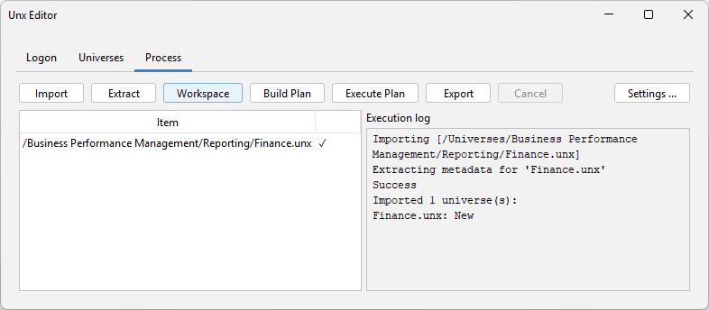

## Features

- **Snapshot Extraction**: Extracts a JSON snapshot of universe metadata (business layer objects, joins, derived tables, tables, contexts, LOVs, parameters) from selected universes on the BIP server. Snapshots are saved per universe to your local project folder for easy review and version control.

- **External JSON Editing**: Edit the extracted JSON snapshots in any text editor or IDE. Make bulk changes to dimensions, measures, folders, joins, derived tables, contexts, LOVs, and parameters — much faster than clicking through the Information Design Tool.

- **Diff & Plan Preview**: Build a change plan that compares the original snapshot against your edited version and produces a human-readable `_plan.json` listing every add, modify, and delete instruction. Review the plan before applying any changes.

- **Plan Execution**: Applies the change plan to the local universe file via the SAP SL SDK. Items are matched by id where available, with a name+type fallback to handle SDK-assigned identifiers correctly.

- **LOV & Parameter Support**: Add, modify, and delete both static and SQL-based List of Values, manage business object LOV associations, and edit Parameter prompt text, data types, and behavior flags.

- **Table Layout Preservation**: Master view x/y positions of tables and derived tables are extracted and applied, so the data foundation diagram stays intact.

- **CLI for Automation**: A headless `unxeditor-cli` command supports scripting and CI/CD pipelines — chain `login`, `select`, `import`, `extract`, `plan`, `execute`, and `publish` commands in a single invocation for unattended bulk universe edits.

Do you need to automate another workflow? We'd love to hear from you at [support@biclever.com](mailto:support@biclever.com)

{:.full}

## Prerequisite

You need SAP BusinessObjects Client Tools for BI 4.3 SP3 and later, including BI 2025, on your machine.

## Information

- [Unx Editor User Guide](/pages/unxeditor-user-guide/)
- [Unx Editor CLI](/pages/unxeditor-cli/)

## Downloads

Without a PRO license the tool runs in free mode: you can extract universe metadata to JSON and diff it against the universe on the server. A PRO license is required to apply changes to a universe and publish it back to the CMS, and to use the CLI for automation.

- [Unx Editor for BI 4.3 SP3 and later, including BI 2025 (unxeditor-20260525.zip)](https://drive.google.com/uc?export=download&id=1P5dX90rUic0WwilqjveLGZ9Tg6cT6MZ4)

## Support

- [support@biclever.com](mailto:support@biclever.com)

